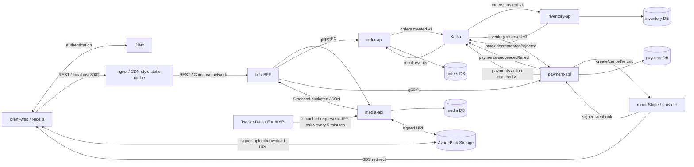

# Service architecture

nginx is the public application API entry point and the `bff` is reachable only inside
the Compose network in local development. The BFF resolves the current product price
from `media-api` and sends the immutable price snapshot to `order-api`. Product and
asset ownership lives in `media-api`; stock mutations live in `inventory-api`; order
state lives in `order-api`.

The exchange-rate experiment sends both implementations through the same nginx entry point.
`GET /api/v1/exchange-rates` is a dynamic BFF-to-`media-api` response cached by nginx under
one stable URL for one second. On a cache miss, the BFF asks `media-api`. `media-api`
refreshes USD/JPY, EUR/JPY, GBP/JPY, and CNY/JPY from Twelve Data in one batched request
at startup and every five minutes, retaining the last complete successful snapshot. Twelve
Data still charges one API credit per symbol. For v2, every second it
publishes a new timestamped file such as `exchange-rates/20261114/20261114120300.json` from those
in-memory rates. Files are stored under UTC date directories; generating a file does not
call Twelve Data. Clients request the current UTC second directly, for example
`GET /api/v2/exchange-rates/20261118/20261118123456.json`.
nginx uses the BFF as its origin and expires v1 and v2 cache entries after one second. The
storefront reads the cached v1 endpoint directly (using the existing 1 point = 1 JPY rule).

Run `scripts/benchmark-exchange-rates.ps1` against the nginx entry point to compare one v1
dynamic cache entry with one v2 timestamped-file cache entry. The script calculates both
cache hit rates from `X-Cache-Status` (`MISS`/`EXPIRED`/`HIT`).
For sustained load testing, `scripts/vegeta-exchange-rates.ps1` runs isolated Vegeta attacks
against both versions and saves latency, throughput, and success-rate reports. Cache hit rates
are observed separately in Grafana. The v2 target URL advances every second to match the
current UTC timestamped file; v1 continues to use its stable dynamic API URL.
nginx also writes a dedicated exchange-rate access log. The `nginx-metrics` sidecar converts
it into Prometheus request counters and latency histograms, which back the Grafana
`PinguCoin / Exchange-rate cache comparison` dashboard.

`client-web` uses locale-prefixed routes (`/ja`, `/en`, `/fr`, `/de`, and `/zh`) through
`next-intl`. Browsing prices are shown as JPY, USD, EUR, EUR, and CNY respectively;
the locale selector displays the corresponding country flag and language name.
Non-Japanese product names are translated on demand through the server-side
`/api/translations` proxy. Successful MyMemory responses are cached for 24 hours on the
server and in TanStack Query; while a translation is pending or unavailable, the original
Japanese product name remains visible. The checkout currency remains JPY.
Japanese pages display the native point price; English storefront pages display an
estimated USD price using the cached exchange rate. Overseas checkout offers card or
bank transfer and always submits `JPY` to the BFF—the converted price is display-only.

Each service owns a separate PostgreSQL database. The databases may run on the
same PostgreSQL server and port in local development, while the database names,
migrations, and direct table access are separated. The BFF is stateless and has no business
database; purchase authorization is checked through `order-api.HasPaidOrder`.

`order-api` has no direct connection to media, inventory, or payment. It commits the
order and `orders.created.v1` outbox record atomically. Inventory consumes that event,
decrements stock immediately, and publishes the result. Payment consumes only successful decrements and
publishes its result. Order consumes both result streams to update state. A payment
failure is also consumed by inventory to perform an idempotent release. Every consumer
uses the order idempotency key, so Kafka redelivery does not duplicate stock or payment.
The order event carries both `payment_method` and `currency`; consumers never infer one
from the other. Card payments remain `processing` until a signed, provider-event-id
deduplicated webhook arrives. Point top-ups credit the point account in the same database
transaction that completes the external payment.

Kafka record handling and offset commits use a 10-second timeout per attempt. Technical
failures are retried up to six times with increasing delays of 500 ms, 1 s, 2 s, 4 s,
and 5 s. A record is committed only after successful processing. If all attempts fail,
the service shuts down so Kubernetes restarts it and Kafka redelivers the uncommitted
record. The BFF's idempotent order RPC has a 10-second overall deadline and retries
`UNAVAILABLE` up to three attempts with exponential backoff.
