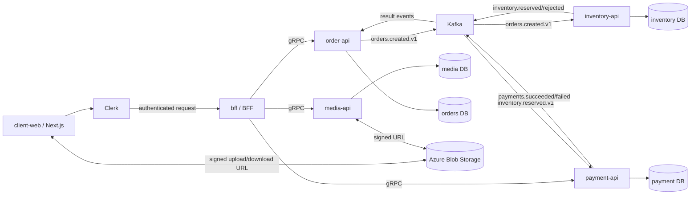

# Service architecture

`bff` is the only public application API. It resolves the current product price
from `media-api` and sends the immutable price snapshot to `order-api`. Product and
asset ownership lives in `media-api`; stock mutations live in `inventory-api`; order
state lives in `order-api`.

Each service owns a separate PostgreSQL database. The databases may run on the
same PostgreSQL server in local development, but schemas, migrations, credentials,
and direct table access are never shared. The BFF is stateless and has no business
database; purchase authorization is checked through `order-api.HasPaidOrder`.

`order-api` has no direct connection to media, inventory, or payment. It commits the
order and `orders.created.v1` outbox record atomically. Inventory consumes that event
and publishes a reservation result. Payment consumes only successful reservations and
publishes its result. Order consumes both result streams to update state. A payment
failure is also consumed by inventory to perform an idempotent release. Every consumer
uses the order idempotency key, so Kafka redelivery does not duplicate stock or payment.
