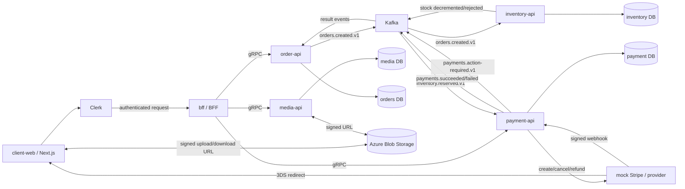

# Service architecture

`bff` is the only public application API. It resolves the current product price
from `media-api` and sends the immutable price snapshot to `order-api`. Product and
asset ownership lives in `media-api`; stock mutations live in `inventory-api`; order
state lives in `order-api`.

Each service owns a separate PostgreSQL database. The databases may run on the
same PostgreSQL server and port in local development, while the database names,
migrations, and direct table access are separated. The BFF is stateless and has no business
database; purchase authorization is checked through `order-api.HasPaidOrder`.

`order-api` has no direct connection to media, inventory, or payment. It commits the
order and `orders.created.v1` outbox record atomically. Inventory consumes that event,
decrements stock immediately, and publishes the result. Payment consumes only successful decrements and
publishes its result. Order consumes both result streams to update state. A payment
failure is also consumed by inventory to perform an idempotent release. Every consumer
uses the order idempotency key, so Kafka redelivery does not duplicate stock or payment.
The order event carries both `payment_method` and `currency`; consumers never infer one
from the other. Card payments remain `processing` until a signed, provider-event-id
deduplicated webhook arrives. Point top-ups credit the point account in the same database
transaction that completes the external payment.

Kafka record handling and offset commits use a 10-second timeout per attempt. Technical
failures are retried up to six times with increasing delays of 500 ms, 1 s, 2 s, 4 s,
and 5 s. A record is committed only after successful processing. If all attempts fail,
the service shuts down so Kubernetes restarts it and Kafka redelivers the uncommitted
record. The BFF's idempotent order RPC has a 10-second overall deadline and retries
`UNAVAILABLE` up to three attempts with exponential backoff.
